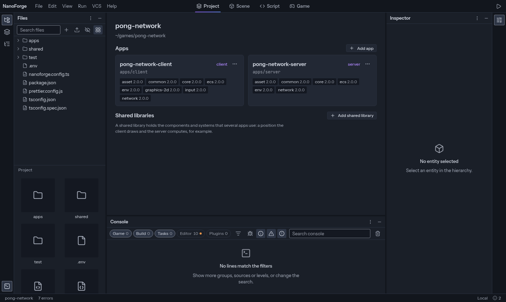

The NanoForge editor is where you build a NanoForge game: its files, its code, its entities, components and systems, and the game itself, running next to them. It runs in the browser, either hosted or on your machine with `nf editor`.

A NanoForge game is **code**. The editor does not keep a scene file of its own: when you add an entity or change a value, it edits your `main.ts`, and what you write by hand shows in its panels.

## Start here

- [Create your first project](/docs/editor/getting-started/create-your-first-project)
- [Find your way around](/docs/editor/editor/overview)

## Using the editor

- [Layout](/docs/editor/editor/layout): panels, screens, saved layouts
- [Files](/docs/editor/editor/files)
- [Code editor](/docs/editor/editor/code-editor)
- [Entities](/docs/editor/editor/entities), [Components](/docs/editor/editor/components) and [Systems](/docs/editor/editor/systems)
- [Play the game](/docs/editor/editor/play): play modes, the Game screen, the console, live editing
- [Settings and shortcuts](/docs/editor/editor/settings)
- [Git](/docs/editor/editor/git)
- [Plugins and packages](/docs/editor/editor/plugins-and-packages)

## Extending the editor

- [Plugins](/docs/editor/plugins/overview): write your own panels, commands and tools
